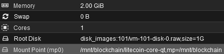

# Preámbulo

En entornos de virtualización con **Proxmox VE**, es común tener una arquitectura mixta:

1. **Una máquina virtual (VM)** ejecutando un sistema de almacenamiento como **TrueNAS SCALE**, encargada de gestionar los discos y compartir carpetas por **SAMBA / CIFS**.
2. **Uno o varios contenedores LXC (no privilegiados)** que necesitan acceder a los datos compartidos por TrueNAS para procesarlos (por ejemplo, servidores multimedia, sincronizadores de bases de datos o servicios de backup).

### El problema

Esta convivencia genera dos dificultades técnicas:

* **Tiempos de arranque desiguales:** Los contenedores LXC inician casi instantáneamente al encender el host Proxmox. Por el contrario, una máquina virtual completa como TrueNAS demora entre 1 y 3 minutos en inicializar el sistema operativo, importar los pools de almacenamiento y levantar el servicio de SAMBA. Si intentamos montar el share en `/etc/fstab` durante el arranque habitual, el montaje fallará por tiempo de espera (*timeout*) o por servidor inalcanzable.
* **Restricciones de contenedores no privilegiados:** Un contenedor LXC no privilegiado no tiene permisos de kernel para montar directamente recursos de red CIFS/SMB desde su interior (comando `mount -t cifs`).

### La solución

El método más robusto y seguro consiste en:
1. **Montar el recurso SAMBA en el propio host de Proxmox** mediante un servicio de `systemd` que aplique un retardo (*delay*), dando tiempo a que la VM de TrueNAS esté 100 % operativa.
2. **Asignar la carpeta montada al contenedor LXC mediante un *bind mount*** con la herramienta `pct`.
3. **Mapear correctamente los permisos de usuario (UID/GID)** para que los procesos del contenedor puedan leer y escribir sin problemas de permisos.
4. **Demorar el inicio de los servicios dependientes dentro del LXC** para evitar que intenten leer la carpeta mientras aún está vacía.

---

# Procedimiento

## Paso 1: Instalar requisitos y crear el punto de montaje en el host

Desde la terminal del **host Proxmox** (como usuario `root`):

1. Instalá las utilidades de CIFS necesarias para soportar montajes SMB:

```bash
apt update && apt install cifs-utils -y
```

2. Creá el directorio local en el host donde se montará la carpeta compartida:

```bash
mkdir -p /mnt/compartido-samba
```

---

## Paso 2: Comprender el mapeo de UID y GID en LXC no privilegiado

En Proxmox, los contenedores no privilegiados utilizan *User Namespaces* para aislar la seguridad. Por defecto, los IDs del contenedor se mapean sumando una base al UID del contenedor.

Para verificar el rango delegado a `root` en el host, ejecutamos:

```bash
cat /etc/subuid | grep root
```

El resultado típico en Proxmox es:

```text
root:100000:65536
```

Esto indica que los IDs delegados al contenedor comienzan en el **100000** y abarcan 65536 números:

```text
UID en el host = UID base (100000) + UID dentro del contenedor
```

* Si el servicio dentro del contenedor corre como **root** (UID 0 dentro del LXC):
  `100000 + 0 = 100000`
* Si el servicio dentro del contenedor corre como un usuario estándar (ej. UID 1000 dentro del LXC):
  `100000 + 1000 = 101000`

> **Importante:** Para que el usuario `root` del contenedor LXC tenga acceso de lectura y escritura a los archivos montados, el montaje en el host debe configurarse con `uid=100000,gid=100000`. Si tu proceso dentro del contenedor corre con otro usuario (por ejemplo UID 1000), deberás usar `uid=101000,gid=101000`.

---

## Paso 3: Crear el archivo de credenciales de SAMBA en el host

Para no exponer la contraseña en texto plano en los scripts de montaje, se crea un archivo de credenciales protegido:

1. Creá el directorio y el archivo de credenciales:

```bash
mkdir -p /root/cifs
nano /root/cifs/credenciales
```

2. Agregá el usuario y contraseña del share de TrueNAS/SAMBA:

```ini
username=mi_usuario_samba
password=mi_contraseña_segura
```

*(Opcional: podés agregar `domain=WORKGROUP` si tu entorno lo requiere).*

3. Asigná permisos restrictivos para que únicamente el usuario `root` del host pueda leer este archivo:

```bash
chmod 600 /root/cifs/credenciales
```

---

## Paso 4: Crear el servicio systemd con retardo en el host Proxmox

En lugar de usar `/etc/fstab` (que se ejecuta inmediatamente en el arranque), crearemos una unidad de servicio en `systemd` que espere a que la red esté activa y aguarde un tiempo prudencial antes de montar el recurso.

1. Creá el archivo de servicio en `/etc/systemd/system/montar-delay.service`:

```bash
nano /etc/systemd/system/montar-delay.service
```

2. Pegá la siguiente configuración adaptando la IP del servidor y las rutas:

```ini
[Unit]
Description=Montaje diferido de recurso compartido SAMBA
After=network-online.target
Wants=network-online.target

[Service]
Type=oneshot
RemainAfterExit=yes
ExecStartPre=/bin/sleep 120
TimeoutStartSec=180
ExecStart=/bin/mount -t cifs //192.168.1.50/mi_share /mnt/compartido-samba -o credentials=/root/cifs/credenciales,uid=100000,gid=100000,iocharset=utf8
ExecStop=/bin/umount /mnt/compartido-samba

[Install]
WantedBy=multi-user.target
```

### Desglose de parámetros clave:
* `Type=oneshot` y `RemainAfterExit=yes`: Permite que systemd ejecute el comando `mount`, marque el servicio como activo (`active (exited)`), y ejecute `ExecStop` (`umount`) cuando el host se apague o reinicie.
* `ExecStartPre=/bin/sleep 120`: Pausa la ejecución durante **120 segundos** (2 minutos), tiempo suficiente para que TrueNAS haya arrancado y SAMBA responda peticiones. Podés ajustar este valor según el tiempo real que tarde tu VM.
* `TimeoutStartSec=180`: Aumenta el tiempo máximo de espera para que systemd no considere que el servicio falló antes de que termine el `sleep` (por defecto systemd cancela a los 90 segundos).
* `uid=100000,gid=100000`: Mapea los archivos al UID 0 del contenedor LXC no privilegiado.

3. Recargá `systemd` y habilitá el servicio para que inicie en cada arranque del host:

```bash
systemctl daemon-reload
systemctl enable montar-delay.service
```

4. **Prueba manual:** Podés verificar el montaje de inmediato iniciando el servicio (o ejecutando el comando de montaje directamente si no querés esperar los 120 segundos de sleep):

```bash
systemctl start montar-delay.service
```

Comprobá que el servicio esté activo y que los archivos sean visibles:

```bash
systemctl status montar-delay.service
ls -la /mnt/compartido-samba
```

---

## Paso 5: Montar la carpeta en el contenedor LXC (Bind Mount)

Con el recurso ya montado en el host, ahora se lo pasamos al contenedor LXC mediante la utilidad de gestión de contenedores de Proxmox (`pct`).

1. Obtené el ID numérico de tu contenedor LXC con:

```bash
pct list
```

2. Añadí el punto de montaje con `pct set`. Si es el primer punto de montaje externo del contenedor, utilizá `-mp0` (si ya tenés uno ocupado, usá `-mp1`, `-mp2`, etc.):

```bash
pct set <ID_LXC> -mp0 /mnt/compartido-samba,mp=/mnt/compartido
```

* `/mnt/compartido-samba` es la ruta en el **host Proxmox**.
* `/mnt/compartido` es la ruta donde se verá dentro del **contenedor LXC**.

> **Nota:** `pct set` actualiza la configuración del contenedor en `/etc/pve/lxc/<ID>.conf`. Aunque el comando se ejecute con el contenedor encendido, el punto de montaje **solo se reflejará dentro del LXC tras reiniciar el contenedor**.

3. Reiniciá el contenedor LXC para que tome los cambios:

```bash
pct reboot <ID_LXC>
```

Podrás corroborar el punto de montaje en la interfaz web de Proxmox (**LXC** > **Recursos** / **Resources**):



4. Verificá el acceso dentro del contenedor ingresando a su consola:

```bash
pct enter <ID_LXC>
ls -la /mnt/compartido
touch /mnt/compartido/test-escritura.txt && rm /mnt/compartido/test-escritura.txt
exit
```

Si el comando `touch` se ejecuta sin errores de "Permission denied", los permisos y el mapeo de UID/GID funcionan a la perfección.

---

## Paso 6: Sincronizar el inicio de los servicios dentro del LXC

Cuando el host físico se reinicia, el contenedor LXC arrancará de inmediato, pero el host Proxmox esperará los 120 segundos del `sleep` antes de montar la carpeta de TrueNAS.

Durante esos primeros dos minutos, la carpeta `/mnt/compartido` dentro del LXC estará vacía. Si una aplicación dentro del contenedor (por ejemplo, una base de datos, un nodo de sincronización o un servicio de backend) arranca de inmediato esperando encontrar archivos en esa ruta, fallará o se comportará de manera errática.

Para solucionarlo, debemos asegurarnos de que el servicio del contenedor espere a que el directorio esté montado y disponible.

### Opción A: Retardo estático mediante systemd (Recomendado)

Si tu aplicación corre como un servicio de systemd (ubicado en `/etc/systemd/system/<nombre-servicio>.service` dentro del LXC):

1. Editá el servicio con:

```bash
nano /etc/systemd/system/<nombre-servicio>.service
```

2. Dentro de la sección `[Service]`, añadí un `sleep` similar o ligeramente superior al del host (por ejemplo, 130 segundos) y aumentá el `TimeoutStartSec`:

```ini
[Unit]
Description=Mi Aplicación Dependiente de SAMBA
After=network.target

[Service]
ExecStartPre=/bin/sleep 130
TimeoutStartSec=180
ExecStart=/usr/local/bin/mi-aplicacion --config /etc/mi-app.conf
ExecStop=/usr/local/bin/mi-aplicacion stop

[Install]
WantedBy=multi-user.target
```

3. Aplicá los cambios en el LXC:

```bash
systemctl daemon-reload
systemctl restart <nombre-servicio>.service
```

---

### Opción B: Espera dinámica hasta que el share tenga contenido

Si preferís que el servicio inicie apenas los archivos estén disponibles sin esperar un tiempo fijo, podés usar un bucle en `ExecStartPre` que verifique si el directorio no está vacío:

```ini
[Service]
ExecStartPre=/bin/sh -c 'until [ "$(ls -A /mnt/compartido 2>/dev/null)" ]; do sleep 5; done'
TimeoutStartSec=240
```

Este comando comprobará cada 5 segundos si `/mnt/compartido` contiene archivos. En cuanto el host realice el montaje, el servicio iniciará inmediatamente.

---

# Diagnóstico y resolución de problemas

* **Error `mount error(111): Connection refused` o `Host is unreachable`:**
  Ocurre si el host intentó montar el recurso antes de que TrueNAS levantara el demonio de Samba. Aumentá el tiempo en `ExecStartPre=/bin/sleep` (por ejemplo, a 150 o 180 segundos).
* **Error `Permission denied` dentro del LXC:**
  El proceso en el LXC no coincide con el UID/GID configurado en el montaje del host. Si el proceso en el contenedor corre como `root`, asegurate de usar `uid=100000,gid=100000`. Si corre con un usuario sin privilegios del LXC (ej. UID 1000), usá `uid=101000,gid=101000`.
* **La carpeta aparece vacía dentro del contenedor:**
  Recordá que `pct set` no aplica montajes en caliente: debés reiniciar el contenedor (`pct reboot <ID>`). Además, asegurate de que en el host el servicio `montar-delay.service` figure en estado `active (exited)`.

---

# Conclusión

1. **El host gestiona el montaje CIFS:** Evitamos violar las restricciones de seguridad de los contenedores no privilegiados delegando la conexión de red SMB al kernel del host.
2. **Mapeo predecible:** Gracias al sistema de sub-UIDs (`100000 + UID_LXC`), los permisos dentro del contenedor coinciden exactamente con lo que necesita tu aplicación.
3. **Arranque sincronizado y resiliente:** Con el retardo controlado en systemd tanto en el host como en el contenedor, todo el entorno puede reiniciar tras un corte eléctrico o mantenimiento sin intervención manual y sin fallos por condiciones de carrera (*race conditions*).
